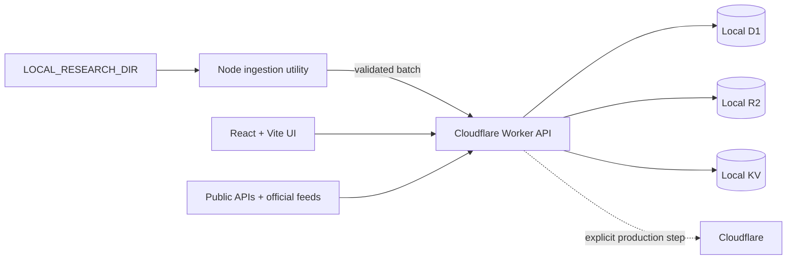

# AMARU AI Observatory

AMARU is a private, local-first intelligence workspace for AI research, providers, models, software, regional signals, and markets. The local Worker retrieves public internet data, normalizes it, stores it in D1, caches synchronization state in KV, and serves the existing React portal without exposing provider secrets to the browser.

The interface is Spanish; code and technical documentation are English. Missing external sources are shown as not configured—never replaced with invented production data. Public no-key synchronization currently covers OpenRouter, Hugging Face, arXiv, OpenAlex, Crossref, GitHub, OpenAI's official RSS, SEC EDGAR, and BCRPData.

## Architecture



Normal development is entirely local. Vite runs the API inside workerd and persists bindings in `.wrangler/state`.

## Requirements

- Windows 10/11 with PowerShell
- Node.js 24 LTS (`.nvmrc` and `.node-version` are included)
- Corepack and pnpm 10

## First local start

From this directory in PowerShell:

```powershell
corepack enable
pnpm install
Copy-Item .dev.vars.example .dev.vars -Force
Copy-Item .env.local.example .env.local -Force
pnpm db:migrate:local
pnpm db:seed:local
pnpm ingest:local
pnpm dev
```

Open [http://127.0.0.1:5174](http://127.0.0.1:5174). The first status request queues enabled public sources once. Use **Administración → Sincronizar todas las fuentes públicas** to run an immediate refresh and inspect per-source HTTP, quota, count, and error state.

The API connection foundation is available at [http://127.0.0.1:5174/developer-lab](http://127.0.0.1:5174/developer-lab). See [docs/developer-lab.md](docs/developer-lab.md) and [docs/developer-lab-api-keys.md](docs/developer-lab-api-keys.md).

`pnpm ingest:local` can run before `pnpm dev`: when necessary it starts a temporary local Worker, imports the batch, and shuts it down.

## Use another local research directory

Edit the ignored `.env.local` file:

```env
LOCAL_RESEARCH_DIR=C:\Data\my-private-research
```

The importer canonicalizes every file, rejects traversal and unsafe symlinks, reads only, and sends only relative display paths to the browser. See [docs/local-library.md](docs/local-library.md).

## Commands

```powershell
pnpm dev                 # local SPA and Worker
pnpm db:migrate:local    # local D1 only
pnpm db:seed:local       # settings only; no fake records
pnpm ingest:local        # one safe local scan
pnpm ingest:watch        # watch the configured directory
pnpm export:local-library
pnpm sources:health
pnpm typecheck
pnpm lint
pnpm test
pnpm exec playwright install chromium
pnpm test:e2e
pnpm build
```

## API credentials

No external key is required. Add optional keys only to ignored `.dev.vars`. Never prefix a secret with `VITE_`, `PUBLIC_`, or `NEXT_PUBLIC_`. See [docs/api-credentials.md](docs/api-credentials.md).

## Cloudflare preparation

`wrangler.jsonc` contains local bindings and placeholder remote identifiers. Do not deploy it unchanged. Create remote D1, R2, KV, and Queue resources, replace placeholders, configure secrets interactively, then run a dry build. Full instructions are in [docs/cloudflare-deployment.md](docs/cloudflare-deployment.md). Nothing is deployed by the project scripts.

The latest executed local verification, known blockers, and release decision are recorded in [docs/verification-report-2026-07-19.md](docs/verification-report-2026-07-19.md).

## Troubleshooting

- **“Requiere migración”**: run `pnpm db:migrate:local` and reload.
- **Import endpoint unavailable**: confirm port 5174 is free, then rerun `pnpm ingest:local`.
- **No files found**: check `LOCAL_RESEARCH_DIR` in `.env.local` and place supported files there.
- **Parser warning**: open the document detail; AMARU preserves the file record and reports the safe parser error.
- **Resetting local state**: back up `.wrangler/state` first. The project never deletes local state automatically.

More detail: [docs/troubleshooting.md](docs/troubleshooting.md).
