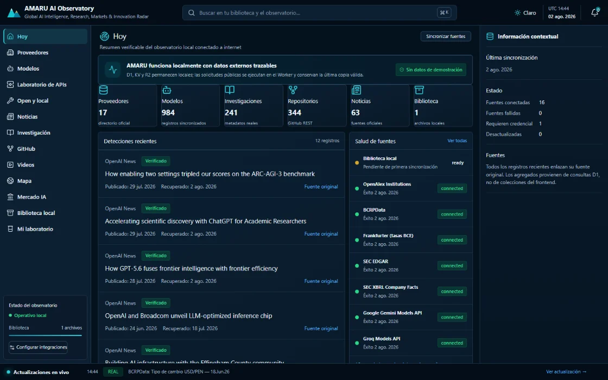
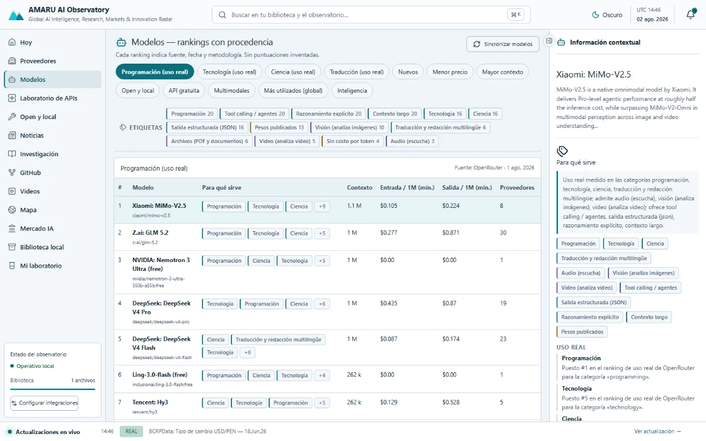
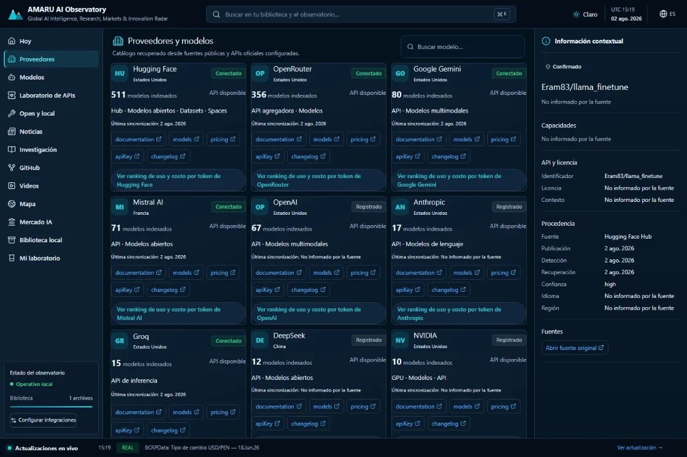
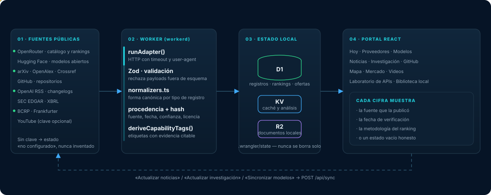
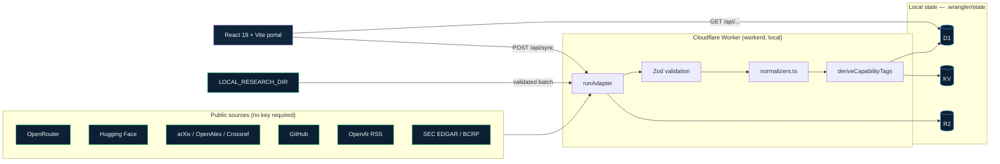
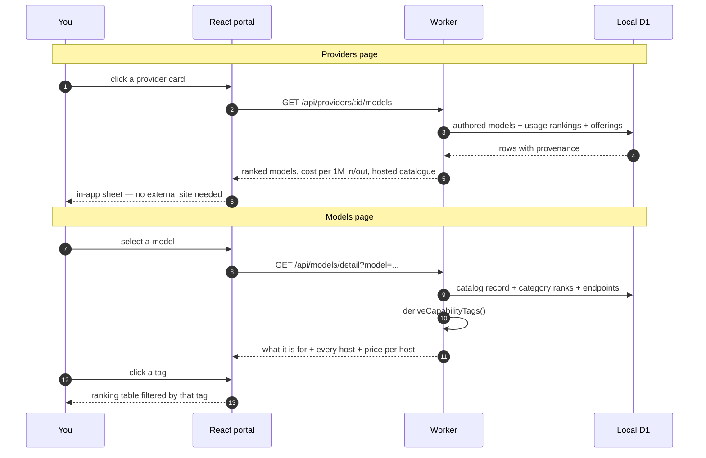
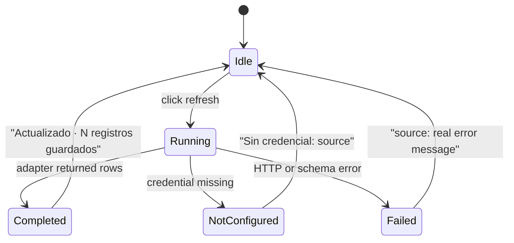

<p align="center">
  
</p>

<p align="center">
  
  
  
  
  
  
</p>

<p align="center">
  <b><a href="https://oprbguitar.github.io/repositoryAmaru/">▶ View the demo showcase</a></b>
  &nbsp;·&nbsp;
  offline: open <code>docs/index.html</code> straight from the repository
</p>

# AMARU AI Observatory

AMARU is a private, local-first intelligence workspace for AI research, providers, models, software, regional signals, and markets. A Cloudflare Worker running on your own machine retrieves public internet data, validates it, normalizes it, stores it in a local D1 database, and serves a React portal — without ever exposing provider secrets to the browser.

> **The core rule:** AMARU never invents a number. Every price, rank, and capability tag on screen can be traced back to the source field that published it. When a source is unavailable, the interface says so instead of filling the gap.

The interface is Spanish; code and technical documentation are English. Public no-key synchronization covers OpenRouter, Hugging Face, arXiv, OpenAlex, Crossref, GitHub, OpenAI's official RSS, SEC EDGAR, and BCRPData.

---

## The interface

<p align="center">
  
</p>

<table>
<tr>
<td width="50%"></td>
<td width="50%"></td>
</tr>
<tr>
<td><b>Modelos</b> — real-usage ranking, evidence-backed capability tags and price per million tokens. Light theme.</td>
<td><b>Proveedores</b> — each card opens its usage ranking and token cost without leaving the app.</td>
</tr>
</table>

Information-first and deliberately quiet: one accent colour, 1px borders instead
of shadows, a 4px spacing scale, and an 11px type floor. Both themes are verified
for WCAG 1.4.3 contrast, and every control clears the 24px target minimum —
checked across 112 views (14 routes × 4 widths × 2 themes). See
[docs/UI_REDESIGN_PLAN.md](docs/UI_REDESIGN_PLAN.md) and
[docs/UI_REDESIGN_REPORT.md](docs/UI_REDESIGN_REPORT.md).

The full walkthrough, including mobile, lives in the
[demo showcase](https://oprbguitar.github.io/repositoryAmaru/) — which is just
`docs/index.html`, so it also opens straight from a local clone with no server.

---

## How data reaches the screen

Public APIs are fetched by adapters, validated with Zod, normalized into a canonical record shape, stamped with provenance, and only then stored. The UI reads from local storage — never directly from a provider.

<p align="center">
  
</p>



Normal development is entirely local. Vite runs the API inside `workerd` and persists all bindings under `.wrangler/state`. Nothing is deployed by any project script.

---

## Model intelligence: what a model is for, and what it costs

Selecting a model answers three questions **inside the app**, with no external lookup:

1. **What is it good for?** — capability tags derived only from fields the source published.
2. **Who hosts it?** — every provider serving that model.
3. **What does it cost?** — input, output and cached price per million tokens, per provider.

<p align="center">
  
</p>

### Where each tag comes from

Tags are produced by [`lib/models/capabilities.ts`](lib/models/capabilities.ts) — a pure, dependency-free function covered by unit tests. **If the signal is absent, the tag is not emitted.** Hovering a tag in the UI shows the evidence sentence.

| Tag | Emitted when | Source field |
| --- | --- | --- |
| Programación · Ciencia · Tecnología · Traducción | the model ranks in that category | `GET /models?category=…` (real usage order) |
| Visión · Audio · Video · Archivos | the modality is declared | `architecture.input_modalities` |
| Genera imágenes / audio / video | the output modality is declared | `architecture.output_modalities` |
| Tool calling / agentes | `tools` is supported | `supported_parameters` |
| Salida estructurada (JSON) | `response_format` is supported | `supported_parameters` |
| Razonamiento explícito | `reasoning` is supported | `supported_parameters` |
| Contexto largo | context ≥ 200 000 tokens (threshold stated in the tag) | `context_length` |
| Sin costo por token | both prices are a published `0` | `pricing.prompt` / `pricing.completion` |
| Pesos publicados | the catalog links the weights | `hugging_face_id` |

A missing price is never treated as free: the tag requires an actual numeric zero, not an absent field.

### Drill-down flow



---

## Keeping the observatory current

Every stream refreshes from its own page — no need to visit an admin screen.

| Page | Button | Scope synchronized |
| --- | --- | --- |
| Noticias | **Actualizar noticias** | official RSS and changelogs |
| Investigación | **Actualizar investigación** | arXiv, OpenAlex, Crossref |
| Modelos | **Sincronizar modelos** | OpenRouter catalog, rankings and endpoints |
| Administración | **Sincronizar todas las fuentes públicas** | every enabled public source |

The result line reports what actually happened — records stored, sources that failed with their error, and sources skipped for a missing credential. A refresh that stored nothing says so.



---

## Modules

| Module | What it shows |
| --- | --- |
| **Hoy** | verifiable digest of everything synchronized |
| **Proveedores** | directory; each card opens its usage ranking and token costs |
| **Modelos** | rankings with provenance, capability tags, tag search, per-host pricing |
| **Laboratorio de APIs** | working test bench against real provider APIs with cost accounting |
| **Open y local** | open-weight and locally runnable models |
| **Noticias · Investigación · GitHub · Videos** | official feeds, papers, repositories, channels |
| **Mapa** | global activity from OpenAlex institution coordinates |
| **Mercado IA** | SEC EDGAR/XBRL filings and economic indicators |
| **Biblioteca local** | your own documents, parsed and optionally analyzed |
| **Mi laboratorio** | project recommendations from indexed capabilities |

---

## Requirements

- Windows 10/11 with PowerShell
- Node.js 24 LTS (`.nvmrc` and `.node-version` are included)
- Corepack and pnpm 10

## First local start

```powershell
corepack enable
pnpm install
Copy-Item .dev.vars.example .dev.vars -Force
Copy-Item .env.local.example .env.local -Force
pnpm db:migrate:local
pnpm db:seed:local
pnpm ingest:local
pnpm dev
```

Open [http://127.0.0.1:5174](http://127.0.0.1:5174). The first status request queues enabled public sources once. Use **Administración → Sincronizar todas las fuentes públicas** for an immediate refresh and to inspect per-source HTTP status, quota, count, and error state.

The API test bench lives at [/developer-lab](http://127.0.0.1:5174/developer-lab) — see [docs/developer-lab.md](docs/developer-lab.md) and [docs/developer-lab-api-keys.md](docs/developer-lab-api-keys.md).

`pnpm ingest:local` can run before `pnpm dev`: when necessary it starts a temporary local Worker, imports the batch, and shuts it down.

## Use another local research directory

Edit the ignored `.env.local` file:

```env
LOCAL_RESEARCH_DIR=C:\Data\my-private-research
```

The importer canonicalizes every file, rejects traversal and unsafe symlinks, reads only, and sends only relative display paths to the browser. See [docs/local-library.md](docs/local-library.md).

## Commands

```powershell
pnpm dev                 # local SPA and Worker
pnpm db:migrate:local    # local D1 only
pnpm db:seed:local       # settings only; no fake records
pnpm ingest:local        # one safe local scan
pnpm ingest:watch        # watch the configured directory
pnpm export:local-library
pnpm sources:health
pnpm typecheck
pnpm lint
pnpm test
pnpm exec playwright install chromium
pnpm test:e2e
pnpm build
```

## Project layout

```
lib/          pure logic — normalizers, rankings, capabilities, path security
worker/       Cloudflare Worker: routes, adapters, module queries
src/          React portal (features/ per module, components/layout for the shell)
migrations/   D1 schema, applied in order
tests/        Vitest units + Playwright e2e
docs/         architecture, data sources, security, deployment
propuesta/    source material — preserved, never edited
```

## API credentials

No external key is required for the public sources. Add optional keys only to the ignored `.dev.vars`. Never prefix a secret with `VITE_`, `PUBLIC_`, or `NEXT_PUBLIC_`. See [docs/api-credentials.md](docs/api-credentials.md).

## Cloudflare preparation

`wrangler.jsonc` contains local bindings and placeholder remote identifiers. Do not deploy it unchanged. Create remote D1, R2, KV, and Queue resources, replace the placeholders, configure secrets interactively, then run a dry build. Full instructions in [docs/cloudflare-deployment.md](docs/cloudflare-deployment.md). Nothing is deployed by the project scripts.

The latest local verification, known blockers, and release decision are recorded in [docs/verification-report-2026-07-19.md](docs/verification-report-2026-07-19.md).

## Troubleshooting

- **“Requiere migración”** — run `pnpm db:migrate:local` and reload.
- **Import endpoint unavailable** — confirm port 5174 is free, then rerun `pnpm ingest:local`.
- **No files found** — check `LOCAL_RESEARCH_DIR` in `.env.local` and place supported files there.
- **Parser warning** — open the document detail; AMARU keeps the file record and reports the safe parser error.
- **Empty ranking** — run **Sincronizar modelos**. AMARU shows an empty state rather than stale or invented positions.
- **Resetting local state** — back up `.wrangler/state` first. The project never deletes local state automatically.

More detail: [docs/troubleshooting.md](docs/troubleshooting.md).

## License

Licensed under the Apache License, Version 2.0. The full, unmodified text is in
[LICENSE](LICENSE); you may also obtain it at
<https://www.apache.org/licenses/LICENSE-2.0>.

- Repository and documentation: <https://github.com/oprbguitar/repositoryAmaru?tab=readme-ov-file>
- Demo showcase: <https://oprbguitar.github.io/repositoryAmaru/>

Unless required by applicable law or agreed to in writing, software distributed
under the License is distributed on an "AS IS" BASIS, WITHOUT WARRANTIES OR
CONDITIONS OF ANY KIND, either express or implied.

All direct production dependencies are permissive and Apache-2.0 compatible
(MIT, ISC, BSD-2-Clause, BSD-3-Clause, Apache-2.0). `package.json` keeps
`"private": true` to prevent accidental npm publication — that flag is a
packaging control and is independent of this license.

> The copyright line in the license appendix is intentionally left as published.
> Fill in the year and copyright owner before distributing releases.
